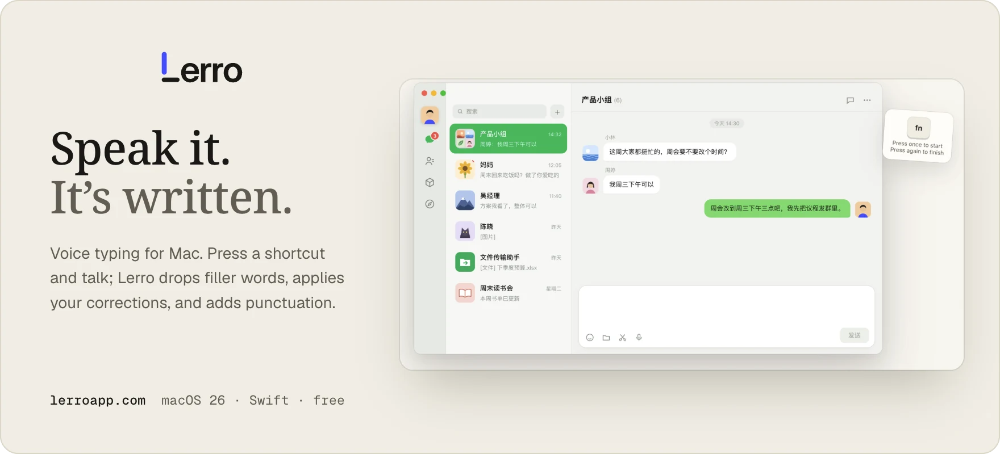
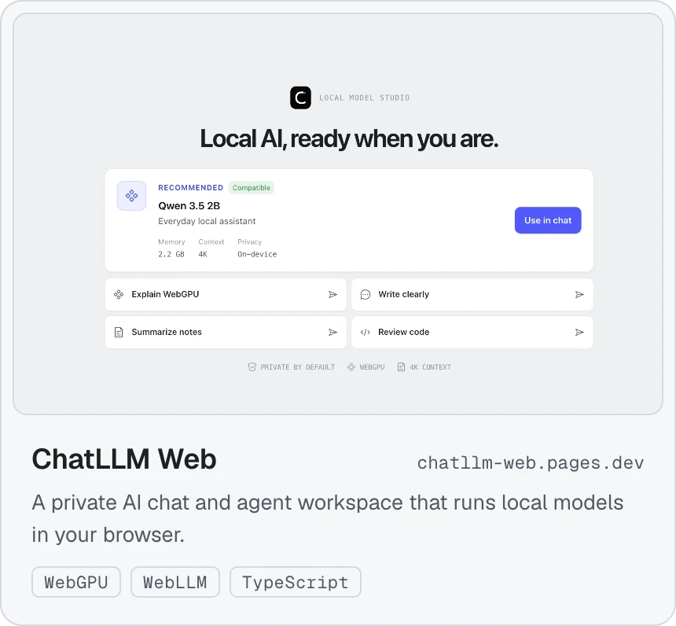
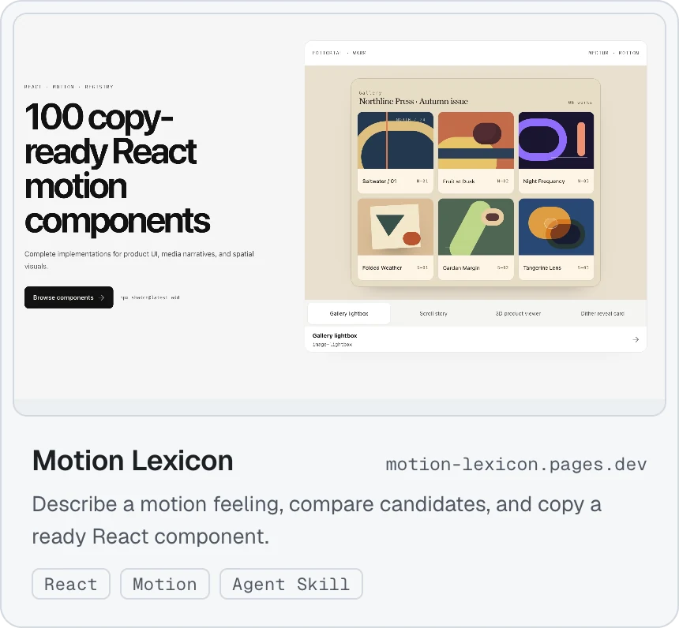
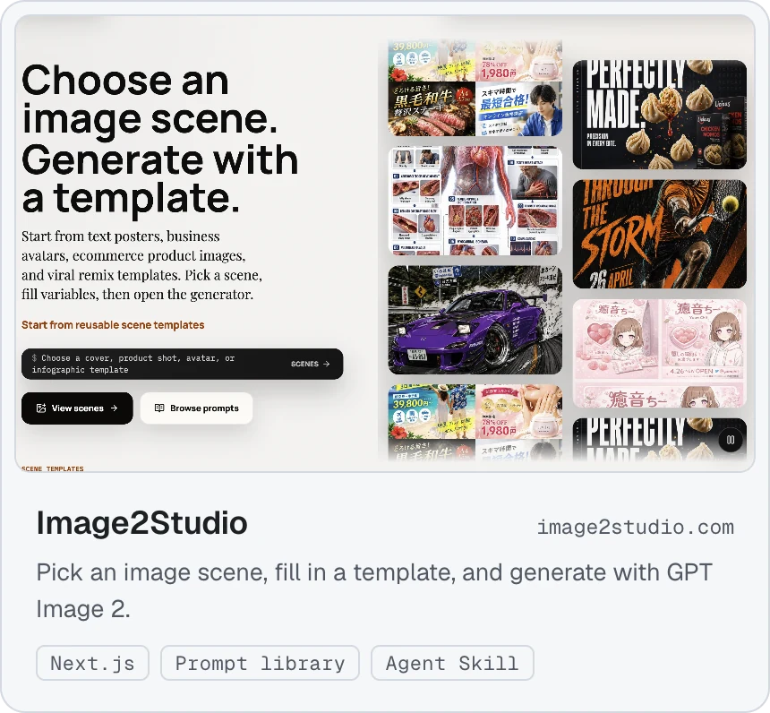
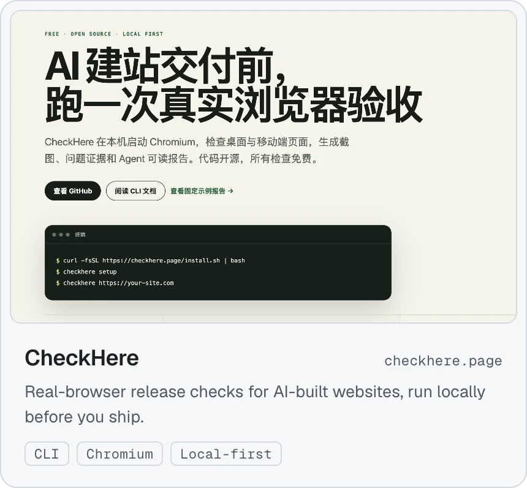

I'm Kris Yang, an independent AI product developer in Shanghai. I design, build, and ship small products for the Mac and the browser.

[ruiy.pages.dev](https://ruiy.pages.dev) · [X @krisyangdev](https://x.com/krisyangdev) · [ruiyang0012@gmail.com](mailto:ruiyang0012@gmail.com)

<a href="https://github.com/krisyangdev/lerro"><picture><source media="(prefers-color-scheme: dark)" srcset="assets/lerro-dark.webp"></picture></a>

  <a href="https://github.com/krisyangdev/ChatLLM-Web"><picture><source media="(prefers-color-scheme: dark)" srcset="assets/chatllm-dark.webp"></picture></a>&nbsp;&nbsp;
  <a href="https://github.com/krisyangdev/motion-lexicon"><picture><source media="(prefers-color-scheme: dark)" srcset="assets/motion-dark.webp"></picture></a>

  <a href="https://image2studio.com"><picture><source media="(prefers-color-scheme: dark)" srcset="assets/image2studio-dark.webp"></picture></a>&nbsp;&nbsp;
  <a href="https://github.com/krisyangdev/checkhere"><picture><source media="(prefers-color-scheme: dark)" srcset="assets/checkhere-dark.webp"></picture></a>

